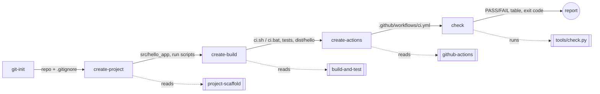

# Архітектура AI-агента `build-engineer`

## Яку проблему вирішує агент

Створення навіть мінімального проєкту включає однакові повторювані кроки:
структура каталогів, `.gitignore`, система складання, тести, CI для трьох ОС,
документація. Ручне виконання призводить до пропусків (немає тесту, забутий
`build/` у Git, CI лише під одну ОС). Агент формалізує ці кроки в skills і
commands, виконує їх у фіксованому порядку і **не вважає роботу завершеною
без автоматичної перевірки** (`tools/check.py`).

## Відповідність файлів ролям (GitHub Copilot, VS Code)

| Роль з методички   | Файл у репозиторії                         | Формат Copilot |
|--------------------|--------------------------------------------|----------------|
| Agent manifest     | `.github/agents/build-engineer.agent.md`   | custom agent (`*.agent.md`) |
| Skill              | `.github/skills/<name>/SKILL.md`           | agent skill (`SKILL.md` з frontmatter `name`, `description`) |
| Command            | `.github/prompts/<name>.prompt.md`         | prompt file, викликається як `/<name>` у чаті |
| Orchestrator       | `.github/prompts/init.prompt.md`           | prompt file `/init` |
| Детермінована перевірка | `tools/check.py`                      | Python-скрипт, викликається командою `check` |

Кожен prompt має `agent: build-engineer` у frontmatter, тому команда завжди
виконується з правилами та обмеженнями manifest.

## Skills

| Skill              | Вхід                                   | Вихід | Перевірка |
|--------------------|----------------------------------------|-------|-----------|
| `project-scaffold` | `language`, `project_name`, `package`  | `src/hello_app/*`, `run.sh`, `run.bat`, `.gitignore`, README | `python -m hello_app` → `Hello, World!` |
| `build-and-test`   | `package`, `executable`                | `ci.sh`, `ci.bat`, `requirements-dev.txt`, `pytest.ini`, `tests/*` | `ci.sh` → `==> CI OK`, `dist/hello`, `test_BasicAddition PASSED` |
| `github-actions`   | `branches`, `python_version`           | `.github/workflows/ci.yml` | YAML валідний, матриця з 3 ОС, без inline-команд складання |

## Commands

| Command          | Skill              | Змінює файли | Дія |
|------------------|--------------------|--------------|-----|
| `git-init`       | —                  | `.gitignore` | перевіряє репозиторій, доповнює `.gitignore`, показує стан Git |
| `create-project` | `project-scaffold` | так | створює Hello World |
| `create-build`   | `build-and-test`   | так | створює складання і тести, запускає `ci.sh` |
| `create-actions` | `github-actions`   | так | створює CI workflow |
| `check`          | —                  | **ні** | запускає `tools/check.py` |
| `init`           | усі                | так | оркестратор |

## Потік даних між етапами

Кожен наступний крок перевіряє передумову, створену попереднім (наприклад,
`create-build` вимагає `src/hello_app/core.py`), і зупиняється з
повідомленням `run <command> first`, якщо її немає.

## Обробка помилок оркестратором

1. Після кожного кроку виконується його блок *Verification*.
2. При помилці `init` друкує `[init] step N/5 <command>: FAILED`, вихід
   команди та пропозицію виправлення і **не запускає наступні кроки**.
3. Успіх оголошується лише якщо `check` (`tools/check.py`) повернув код 0.
4. Повторний запуск `init` безпечний: кожна команда створює лише відсутні
   файли й не дублює рядки `.gitignore` чи job-и workflow (це також
   перевіряє `check`: дублікати в `.gitignore`, рівно один job).

## Обмеження агента

- Підтримує лише Python (варіант 2); для іншої мови skill зупиняється.
- Не пушить, не створює PR, не переписує історію Git — це робить студент.
- Результат LLM недетермінований: тому фінальне рішення про успіх приймає
  детермінований `tools/check.py`, а не модель.
