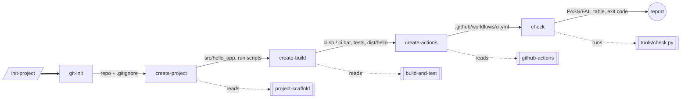

# Архітектура AI-агента `build-engineer`

## Яку проблему вирішує агент

Створення навіть мінімального проєкту включає однакові повторювані кроки:
структура каталогів, `.gitignore`, система складання, тести, CI для трьох ОС,
документація. Ручне виконання призводить до пропусків (немає тесту, забутий
`build/` у Git, CI лише під одну ОС). Агент формалізує ці кроки в skills і
commands, виконує їх у фіксованому порядку і **не вважає роботу завершеною
без автоматичної перевірки** (`tools/check.py`).

## Відповідність файлів ролям (Claude Code)

Методичка описує агента у форматі GitHub Copilot. Агент виконано для
**Claude Code** (дозволено використовувати будь-який AI-клієнт), тому
каталоги інші. Відповідність:

| Роль з методички        | Файл у репозиторії                      | Формат Claude Code |
|-------------------------|-----------------------------------------|--------------------|
| Agent manifest          | `.claude/agents/build-engineer.md`      | subagent (frontmatter `name`, `description`, `tools`) |
| Підключення manifest    | `CLAUDE.md` (`@.claude/agents/build-engineer.md`) | project memory, завантажується в кожну сесію |
| Skill                   | `.claude/skills/<name>/SKILL.md`        | agent skill (frontmatter `name`, `description`) |
| Command                 | `.claude/commands/<name>.md`            | slash-команда `/<name>` (frontmatter `description`, `allowed-tools`, `argument-hint`) |
| Orchestrator            | `.claude/commands/init-project.md`      | `/init-project` (`/init` зайнята вбудованою командою) |
| Обмеження (forbidden)   | `.claude/settings.json`                 | `permissions.deny`: `git push`, `git reset --hard`, `git rebase`, `git clean`, читання `.env` |
| Детермінована перевірка | `tools/check.py`                        | Python-скрипт, викликається командою `/check` |

| Copilot (методичка)               | Claude Code (цей репозиторій)   |
|-----------------------------------|---------------------------------|
| `.github/agents/*.agent.md`       | `.claude/agents/*.md`           |
| `.github/prompts/*.prompt.md`     | `.claude/commands/*.md`         |
| `.github/skills/*/SKILL.md`       | `.claude/skills/*/SKILL.md`     |
| `agent: build-engineer` у prompt  | `@.claude/agents/build-engineer.md` у тілі команди + `CLAUDE.md` |
| `tools:` у frontmatter            | `allowed-tools:` у frontmatter команди |

Кожна команда починається з посилання `@.claude/agents/build-engineer.md`,
тому виконується з правилами та обмеженнями manifest. `allowed-tools`
визначає, які інструменти команда використовує без додаткового запиту;
у `/check` немає `Edit`/`Write`, тож спроба змінити файл потребувала б
явного дозволу користувача (це також перевіряє `tools/check.py`).

## Skills

| Skill              | Вхід                                   | Вихід | Перевірка |
|--------------------|----------------------------------------|-------|-----------|
| `project-scaffold` | `language`, `project_name`, `package`  | `src/hello_app/*`, `run.sh`, `run.bat`, `.gitignore`, README | `python -m hello_app` → `Hello, World!` |
| `build-and-test`   | `package`, `executable`                | `ci.sh`, `ci.bat`, `requirements-dev.txt`, `pytest.ini`, `tests/*` | `ci.sh` → `==> CI OK`, `dist/hello`, `test_BasicAddition PASSED` |
| `github-actions`   | `branches`, `python_version`           | `.github/workflows/ci.yml` | YAML валідний, матриця з 3 ОС, без inline-команд складання |

## Commands

| Command          | Skill              | Змінює файли | Дія |
|------------------|--------------------|--------------|-----|
| `git-init`       | —                  | `.gitignore` | перевіряє репозиторій, доповнює `.gitignore`, показує стан Git |
| `create-project` | `project-scaffold` | так | створює Hello World |
| `create-build`   | `build-and-test`   | так | створює складання і тести, запускає `ci.sh` |
| `create-actions` | `github-actions`   | так | створює CI workflow |
| `check`          | —                  | **ні** | запускає `tools/check.py` |
| `init-project`   | усі                | так | оркестратор |

## Потік даних між етапами

Кожен наступний крок перевіряє передумову, створену попереднім (наприклад,
`create-build` вимагає `src/hello_app/core.py`), і зупиняється з
повідомленням `run <command> first`, якщо її немає.

## Обробка помилок оркестратором

1. Після кожного кроку виконується його блок *Verification*.
2. При помилці `/init-project` друкує `[init-project] step N/5 <command>: FAILED`, вихід
   команди та пропозицію виправлення і **не запускає наступні кроки**.
3. Успіх оголошується лише якщо `check` (`tools/check.py`) повернув код 0.
4. Повторний запуск `/init-project` безпечний: кожна команда створює лише відсутні
   файли й не дублює рядки `.gitignore` чи job-и workflow (це також
   перевіряє `check`: дублікати в `.gitignore`, рівно один job).

## Обмеження агента

- Підтримує лише Python (варіант 2); для іншої мови skill зупиняється.
- Не пушить, не створює PR, не переписує історію Git — це робить студент.
- Результат LLM недетермінований: тому фінальне рішення про успіх приймає
  детермінований `tools/check.py`, а не модель.
